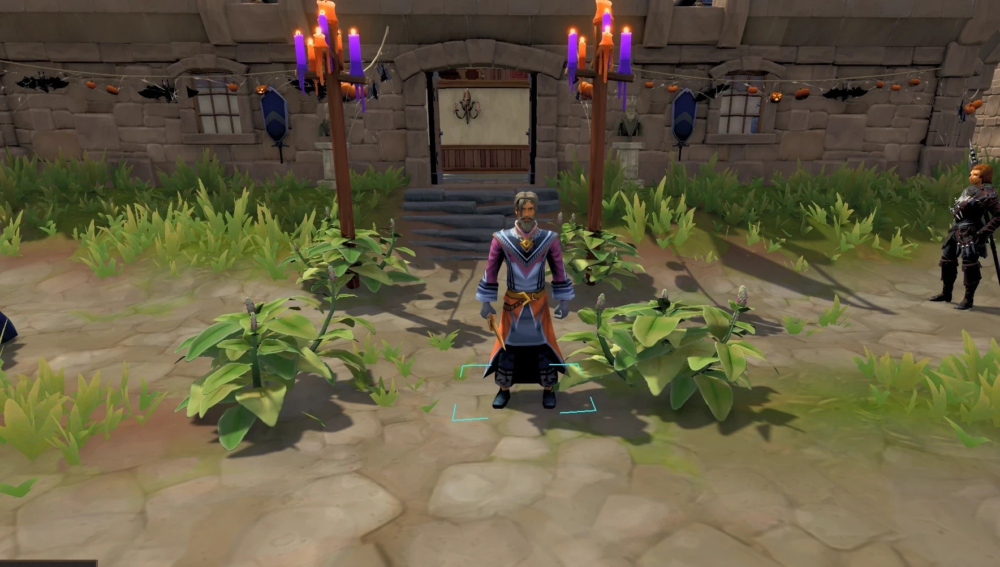
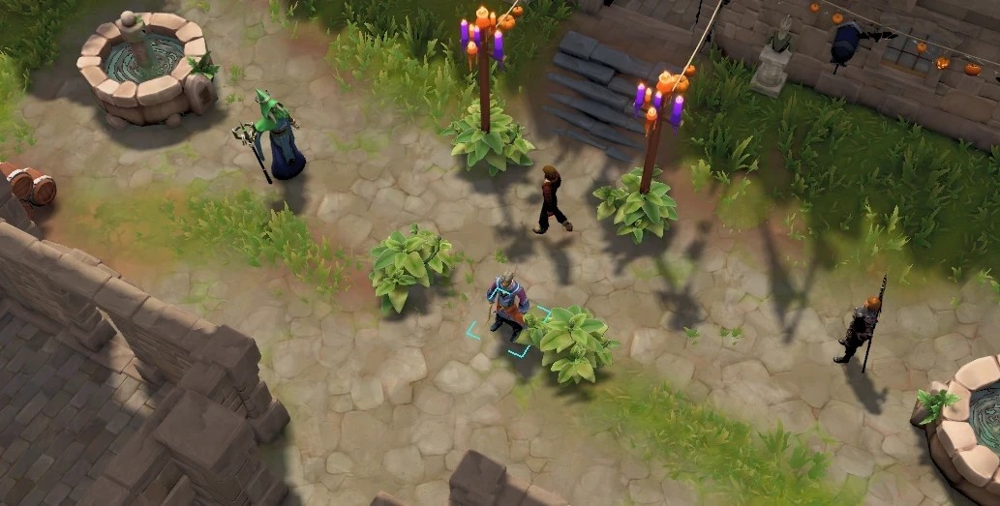
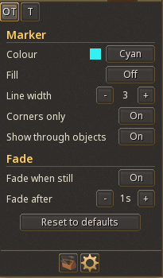
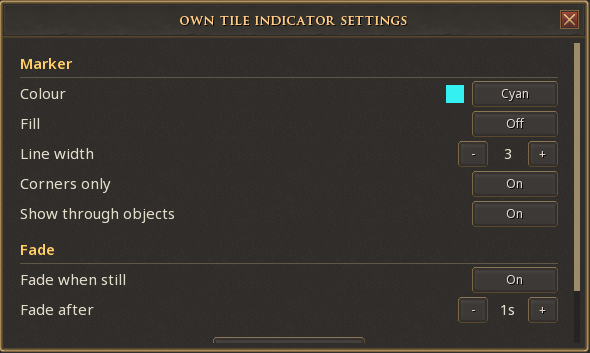

# Own Tile Indicator

An RS3 plugin that marks the tile your character is standing on, like the tile indicators in RuneLite.

## What it does

- Draws an outline on the tile under your character and moves with you as you walk, run or teleport
- Follows the slope of the ground, so the marker doesn't sink into hills
- Can show through objects, or sit behind them like normal ground
- Fades out after you stand still for a few seconds and comes back as soon as you move. The delay goes from 1 second to a minute, or the fade can be turned off
- Colour, fill, line width, corners only and the fade can all be changed in the settings

The marker follows your character model, so it always matches what's on screen. It doesn't show the server-side tile.

## Settings

Click the plugin's icon in the Plugins window, or the cog next to it under Manage in the Plugin Hub. Both open the same settings, and changes show on the marker straight away.

  
  

## Installing

Find Own Tile Indicator in the Plugin Hub and enable it under Manage. It doesn't need any other plugins.

## Testing it locally

Plugins that aren't on mod.io only load on the beta client.

1. Put this folder at `C:\ProgramData\Jagex\RuneScape-BETA\dev_plugins\own-tile-indicator`
2. Start the beta. Press Win+R and paste
   `jagex:launch=runescape,args=[configURI=rs-launch://www.runescape.com/jav_config_beta.ws]`
3. Log in. The first time, import your save in the lobby
4. Open the console with Alt + ` and type `pon own-tile-indicator`

After changing a lua file, run `prl own-tile-indicator` to reload it.

## Changes

See [CHANGELOG.md](CHANGELOG.md).
